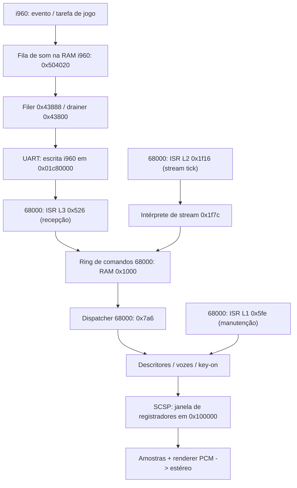

# Sistema de som do Virtua Fighter 2.1 (Sega Model 2A)

> **Guia técnico inicial, baseado nas evidências já presentes neste repositório.**
> Revisão: 2026-10-16, base consultada: [`9eaf0f645b76`](https://github.com/celsowm/vf2-decomp/commit/9eaf0f645b76b99d6eee8705839379913e1cca45).
> Este texto **não** é o relatório final da Pesquisa Aprofundada. Não contém medições
> novas, não substitui as notas de recuperação e não afirma que uma implementação
> é fiel ao silício sem diferencial. Leia [AGENTS.md](../AGENTS.md) antes de alterar C.

## Objetivo e fontes de verdade

O alvo é **Virtua Fighter 2 Version 2.1**, conjunto MAME `vf2`, placa
**Model 2A**, CPU principal **Intel i960** e programa de som **Motorola 68000**.
O manifesto e as regiões reconstruídas estão em
[ROM_LAYOUT.md](ROM_LAYOUT.md) e [config/vf2_v22_roms.csv](../config/vf2_v22_roms.csv).
O som usa uma interface de registradores **SCSP-family**, com 32 slots de
`0x20` bytes: isso foi verificado pela ROM do 68000, e não inferido de uma
página genérica sobre Model 2. A hipótese de usar a interface **MultiPCM**
para *este programa* foi rejeitada no
[audit v0805](../decomp/i960/notes/audio_silicon_audit_scsp_confirmed_v0805.md).

Hierarquia de evidências para esta recuperação: **ROM legalmente obtida e
passos do executor 68000/i960 > diferencial de estados e acessos > código
recuperado com testes > implementação de referência (MAME) > manual de outro
sistema / relato secundário**. MAME é referência, não prova de equivalência
do projeto. Não copiar código, ROM, tabelas ou amostras proprietárias.

## Visão funcional

**Atenção:** o diagrama combina *caminhos recuperados* com conexões cuja
ativação no gameplay continua em aberto. A sessão atualmente usa um
**shadow i960** em `vf2_session_pump_audio` para drenar a fila e chamar
`vf2_sound_board_file_uart_byte`; isso é uma ponte de software
instrumentada, **não** prova de que a UART/IRQ está integralmente emulada.
O drainer usa **`0x01c80000`**, e **não `0x009c0000`**: a correção está em
[audio_8f_drainer_v0825.md](../decomp/i960/notes/audio_8f_drainer_v0825.md)
e no [session.c](../src/app/session.c).

## O que está efetivamente demonstrado

| Tema | Estado da evidência | Referência |
|---|---|---|
| Identificação do conjunto e tamanhos das regiões | Manifesto do projeto, `vf2` / Model 2A | [ROM_LAYOUT](ROM_LAYOUT.md) |
| SCSP-family em vez de MultiPCM | Desmontagem do driver, slots de `0x20`, master `0x0400` | [v0805](../decomp/i960/notes/audio_silicon_audit_scsp_confirmed_v0805.md) |
| Caminho i960 fila -> bytes -> ring 68000 | Diferenciais e composição; produção de eventos de gameplay não fechada | [T5](../decomp/i960/notes/audio_t5_closeout_v0825.md), [8h](../decomp/i960/notes/audio_8h_bridge_v0825.md) |
| Recepção 68000 e ring de 4 bytes | Diferencial da ISR L3 com RAM/registradores/SCSP | [8g](../decomp/i960/notes/audio_8g_l3file_v0825.md) |
| Dispatcher / configuração de vozes | Recuperações C e testes com executor 68000 | [E1c](../decomp/i960/notes/audio_e1c_recovered_v0825.md), [E1o](../decomp/i960/notes/audio_e1o_loopb_wiring_v0825.md) |
| Key-on e render audível | Um caminho `0xed8` conclui com `VF2_OK`; render determinístico no fixture | [E1c](../decomp/i960/notes/audio_e1c_recovered_v0825.md) |
| Manutenção L1 e expiração de voz | Composição de cinco ticks C-vs-stepper | [E1f-d](../decomp/i960/notes/audio_e1fd_lifecycle_v0825.md) |
| Seleção de FM pelo programa de som | Varredura da ROM não encontrou escritor real que selecione FM; **não** significa que o chip não tenha FM | [v0807](../decomp/i960/notes/audio_fm_boundary_measured_v0807.md) |
| Timbre, DSP, envelope, pitch e loop com fidelidade de hardware | **Ainda não comprovados** por um oráculo de áudio do silício | [README](../README.md), [scsp.h](../include/vf2/scsp.h) |

**Correção histórica importante:** a afirmação de v0805 de que a música
necessariamente usa FM foi **retratada** após a varredura da ROM em v0807.
Não tomar notas anteriores como status atual sem conferir os documentos
posteriores e o código em `master`.

## Pontos de entrada para investigação

- [Mapa de memória, filas, registros e interrupções](sound/MEMORY_MAP.md).
- [Atlas de opcodes 68000/i960, PCs, flags e MMIO](sound/OPCODE_ATLAS.md).
- [Comandos de desmontagem raw e traces por opcode](sound/OPCODE_TRACE.md).
- [Procedimento de instrumentação e validação diferencial](sound/REVERSE_ENGINEERING.md).
- [decomp/m68k/README.md](../decomp/m68k/README.md): recuperação detalhada
  dos comandos, loops e tabelas do programa 68000.
- [include/vf2/sound_board.h](../include/vf2/sound_board.h),
  [src/hardware/sound_board.c](../src/hardware/sound_board.c):
  estado e API de som; [include/vf2/scsp.h](../include/vf2/scsp.h)
  e [src/hardware/scsp.c](../src/hardware/scsp.c): registradores e PCM.
- [decomp/i960/notes/](../decomp/i960/notes/): notas `audio_*.md` por
  recuperação; preferir as correções mais recentes.

## Correção de proveniência do evento (v0855)

A análise estática da ROM identificou um erro de atribuição do relatório
v0854: `fighter + 0x1b1` é o **tipo do personagem**, confirmado pelas
rotinas de jogador, e **não** um identificador independente de evento
sonoro. O driver i960 em `0x4396c` lê esse campo e em `0x43974` lê
`fighter + 0x624`. Neste segundo campo, 38 dos 39 candidatos de
escrita direta têm sequências locais de zeragem comprováveis, incluindo `0x14120..0x14190`; `0x23b44`
faz parte de `fa_coli`/`0x23878` (remapeamento de bits de colisão,
medido anteriormente em v0283), **não é prova de um evento de áudio**. Isso **não**
prova que `+0x624` seja o gatilho: só um evento real com trace e
diferencial pode fechar essa lacuna.

Evidência, contagens, ferramenta e cinco testes sem ROM:
[nota v0855](../decomp/i960/notes/audio_source_frontier_v0855.md) e
[analisador](../tools/python/audio_field_xrefs.py).

## Fronteiras abertas prioritárias

1. Capturar **um evento real de gameplay** que chegue ao filer, com
   contexto e estado de pré-evento reprodutíveis (não confundir fixture
   sintético com integração do jogo).
2. Validar a relação entre tick **L2**, ring, key-on e render **durante a
   sessão**, sem violar o contrato de estado do i960.
3. Recuperar o **reaper `0xf50`** e as saídas ainda recusadas; o
   [E1o](../decomp/i960/notes/audio_e1o_loopb_wiring_v0825.md) já
   fixa a chegada por exaustão das 32 vozes.
4. Medir a seleção de bancos, endereços de amostra e parâmetros de
   envelope/pitch/loop; diferenciar comportamento da ROM de aproximações
   atuais do renderer.
5. Obter uma referência externa de **PCM temporalmente alinhada** e
   comparar frames/amostras, sem versionar áudio extraído nem dumps.

Esses itens são **propostas de experimento**, não trabalhos executados
na criação deste documento.

## Referências externas e limites

- [MAME: driver Sega Model 2](https://github.com/mamedev/mame/blob/master/src/mame/sega/model2.cpp)
  — documentação executável auxiliar; confrontar cada registrador com a ROM.
- [MAME: implementação SCSP](https://github.com/mamedev/mame/blob/master/src/devices/sound/scsp.cpp)
  — referência de interpretação de registradores, **não** oráculo de
  equivalência de áudio.
- [docs/REFERENCES.md](REFERENCES.md) e [docs/LEGAL.md](LEGAL.md).
- O manual do **SCSP do Saturn** pode sugerir nomes e bits, mas não é
  evidência automática do mapeamento completo da placa Model 2A.
  Um manual público de desenvolvimento Model 2 equivalente ainda precisa
  ser localizado e validado por fontes primárias.

Nenhum arquivo de ROM, trecho de ROM, WAV, trace integral ou código
proprietário é incluído aqui.
